<p align="center">
  <picture>
    <source media="(prefers-color-scheme: dark)" srcset="docs/assets/readme/banner-dark.svg">
    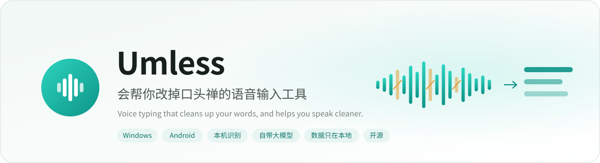
  </picture>
</p>

<p align="center">
  <a href="README.md">简体中文</a> · <b>English</b>
</p>

<p align="center">
  <a href="https://github.com/despriber/Umless/releases/latest"></a>
  <a href="https://github.com/despriber/Umless-Android"></a>
  
  <a href="LICENSE"></a>
  
</p>

<p align="center">
  Hold a key and talk; let go and you get clean text. Keep using it and the way you speak gets cleaner too.
</p>

<p align="center">
  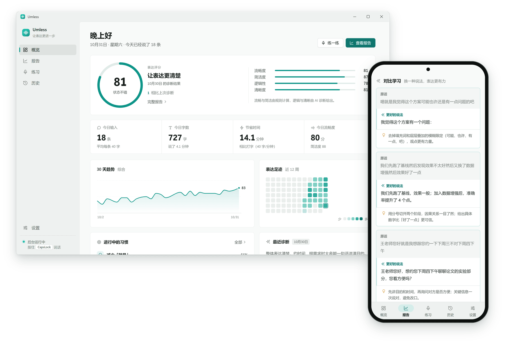
</p>

"Voice typing + LLM cleanup" tools already delete the *um*, *like* and *you know* from your text, but only from the text: the habit stays.
Umless does one more thing: **it keeps what you actually said on your device, counts your fillers, repetitions and self-corrections, gives you a daily expression report, and uses habit cards and speaking practice to help you actually drop them.**

Umless is Chinese-first: the filler list (嗯、那个、就是、然后…), self-correction markers (不对、我是说…) and the screenshots below are Chinese. The app UI itself is available in Simplified Chinese and English.

<p align="center">
  <picture>
    <source media="(prefers-color-scheme: dark)" srcset="docs/assets/readme/before-after-dark.svg">
    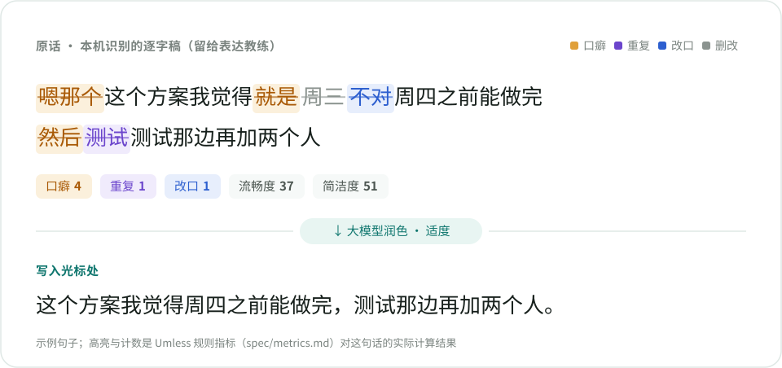
  </picture>
</p>
<p align="center"><sub>Top: the raw transcript, with fillers (amber), a repetition (violet), a self-correction (blue) and the words it replaced (grey).<br>Bottom: what gets typed: "I think this plan can be done before Thursday; testing needs two more people."</sub></p>

## Why Umless

- **Typing and improving are the same activity.** You dictate as usual; the expression coach works from the same transcripts in the background, so there is no separate "practice mode" needed to collect data.
- **Chinese-first.** A built-in list of Chinese fillers, detection of self-corrections, and repetition rules that leave normal reduplication (看看、谢谢) alone.
- **Scores you can trust and reproduce.** Fluency and concision come from local rules (a character-level diff; a filler only counts if the polish removed it). Only logic and clarity are judged by the LLM. The algorithms are written down in [`spec/metrics.md`](spec/metrics.md) and verified on both desktop and Android against the same golden cases.
- **Your data stays on your device.** Recordings are not kept by default, history lives in a local SQLite database, the LLM is any OpenAI-compatible endpoint you choose (a local Ollama works), and there is no telemetry.

<p align="center">
  <picture>
    <source media="(prefers-color-scheme: dark)" srcset="docs/assets/readme/coach-loop-en-dark.svg">
    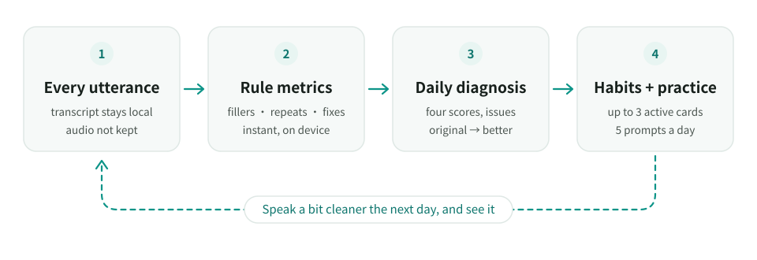
  </picture>
</p>

## Features

### Everyday dictation, in any app

<p align="center">
  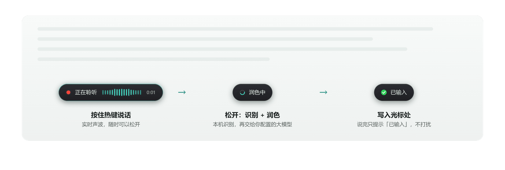
</p>

- **Any hotkey, hold to talk.** CapsLock by default (a tap still toggles caps), or record any key or combination, e.g. `Ctrl+Space`, `F8`, right Ctrl.
- **On-device recognition.** SenseVoice-Small via sherpa-onnx by default (CPU is enough; RTF about 0.04 in the repo benchmark). Switch to Qwen3-ASR for better accuracy and punctuation, or to a cloud endpoint.
- **Three polish levels:** *faithful* (remove fillers, fix errors, punctuate) · *moderate* (also merge repeats, smooth the order) · *restructure* (lead with the conclusion, paragraphs and bullet points). No level adds information; numbers, names, negations and times are kept as said.
- **Style follows the foreground app:** chat, document, code and email scenes, each with its own level; the code scene keeps identifiers and English terms intact.
- A **glossary** fixes proper nouns; if the LLM times out or isn't configured, the raw transcript is typed instead.
- **Unobtrusive:** the overlay never takes focus and lets clicks through; the only feedback is "typed".

<table>
  <tr>
    <td width="50%">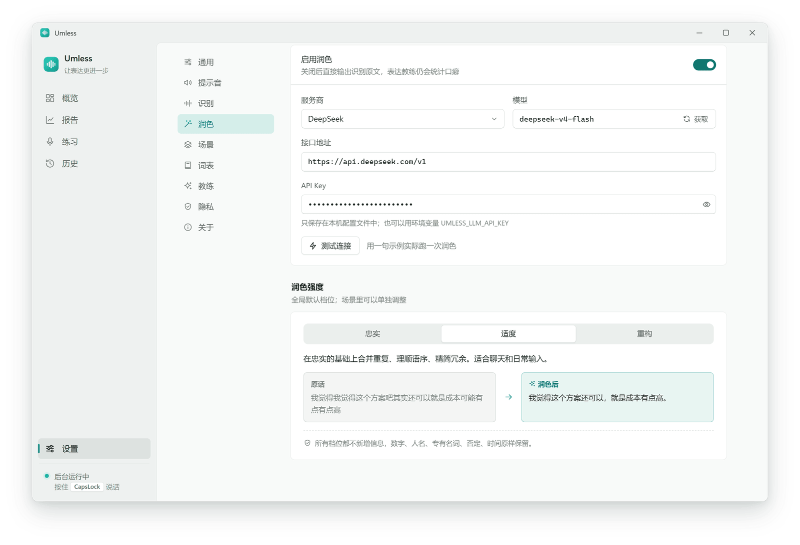</td>
    <td width="50%">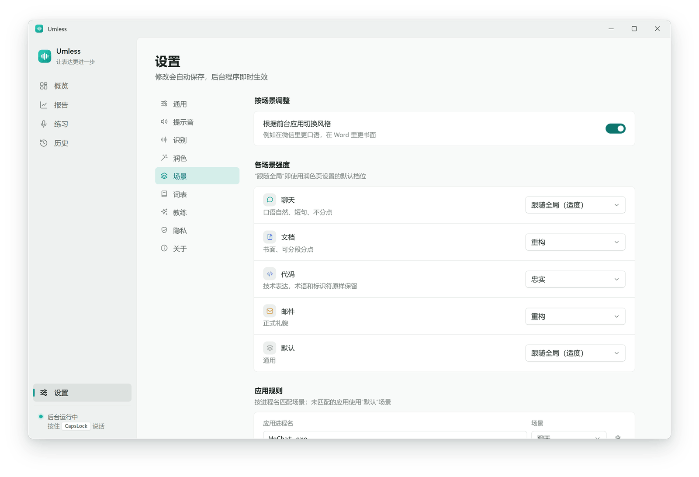</td>
  </tr>
  <tr>
    <td align="center"><sub>Bring your own LLM (presets for Ollama, DeepSeek, SiliconFlow, Alibaba Bailian, Zhipu, or any compatible API)</sub></td>
    <td align="center"><sub>Scenes switch by foreground app, each with its own level</sub></td>
  </tr>
</table>

### Expression coach: a daily report

<p align="center">
  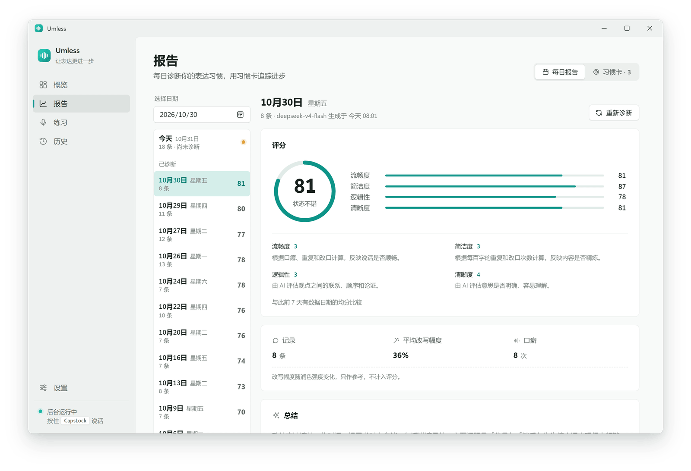
</p>

- **Four scores:** fluency and concision from local rules; logic and clarity from the LLM on a fixed rubric. Overall = fluency 30% + concision 20% + logic 25% + clarity 25%.
- **Yesterday is diagnosed automatically** (or diagnose today at any time): a summary, what went well, issues with quoted evidence and advice, newly discovered personal fillers, and terms that keep getting misrecognised (one click adds them to the glossary).
- **Before → after examples** picked from what you said that day: the original, a better way to say it, and why.

<p align="center">
  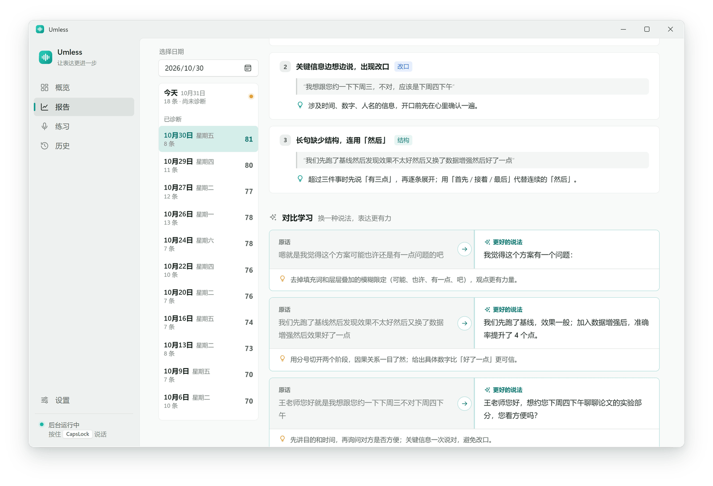
</p>

### Habit cards: progress you can see

<p align="center">
  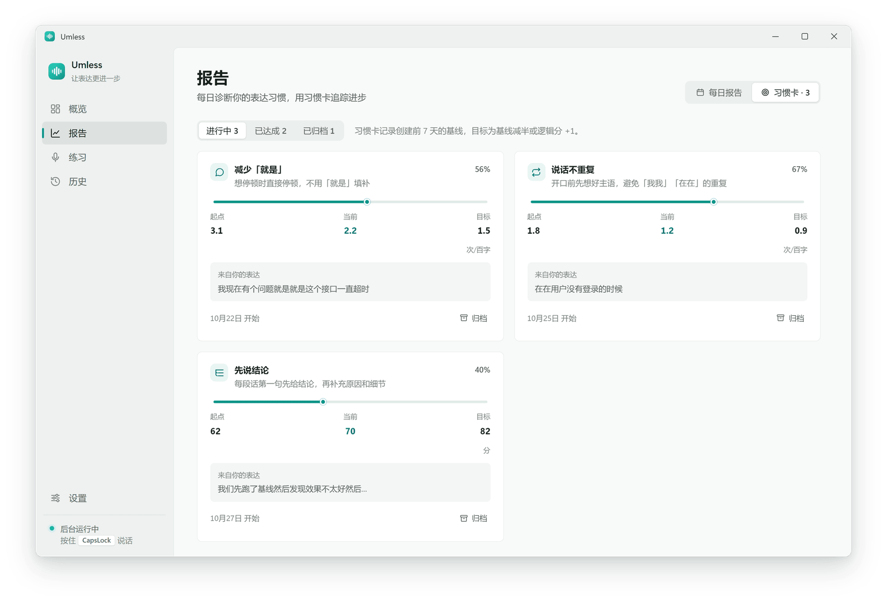
</p>

Measurable issues from the diagnosis become habit cards (up to 3 active): the density of one filler word, repetitions, self-corrections, or the logic / clarity score. Each card records a 7-day baseline before it was created and aims to halve it (or raise the LLM score by one step); it is marked as reached when the last 7 days meet the target with enough samples.

### Speaking practice: 5 prompts a day

<p align="center">
  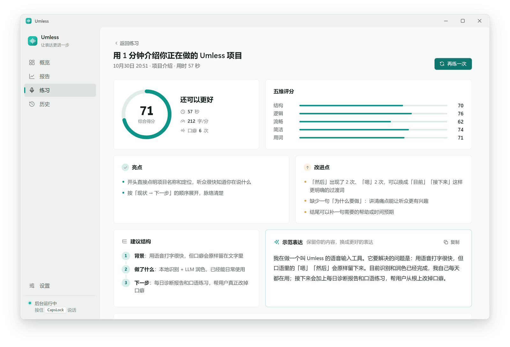
</p>

Some prompts are based on what you have been talking about lately (projects, research), others are common situations (status updates, interviews, explaining a concept, giving an opinion); you can add your own. Speak for 60 or 90 seconds and get scores for structure, logic, wording, fluency and concision, plus strengths, improvements, a suggested structure and a model answer that keeps your content.

### History: every original sentence, annotated

<table>
  <tr>
    <td width="50%">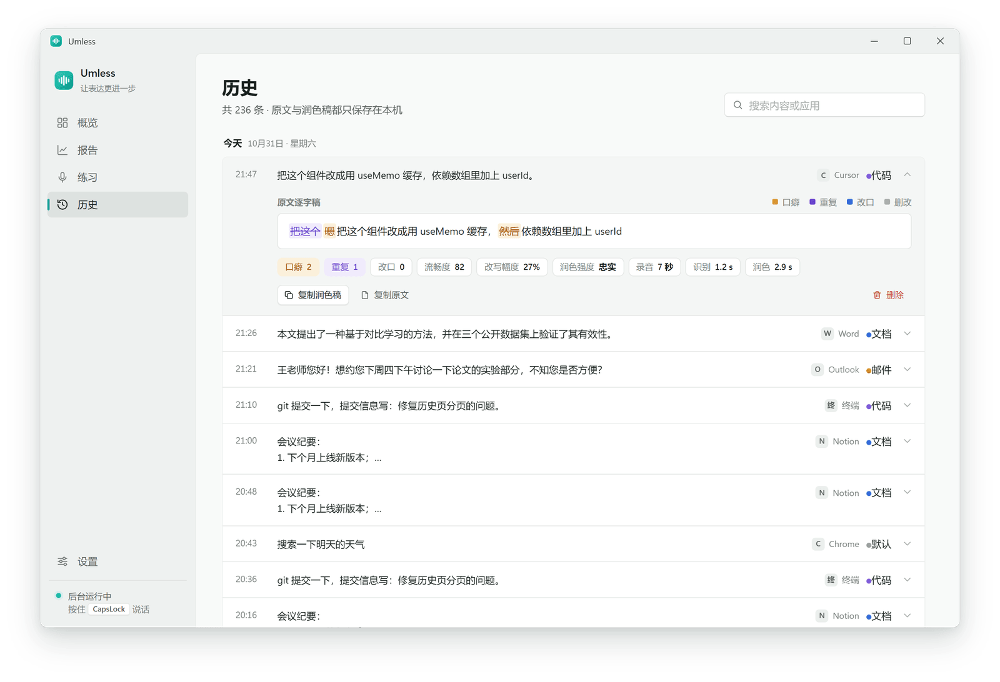</td>
    <td width="50%">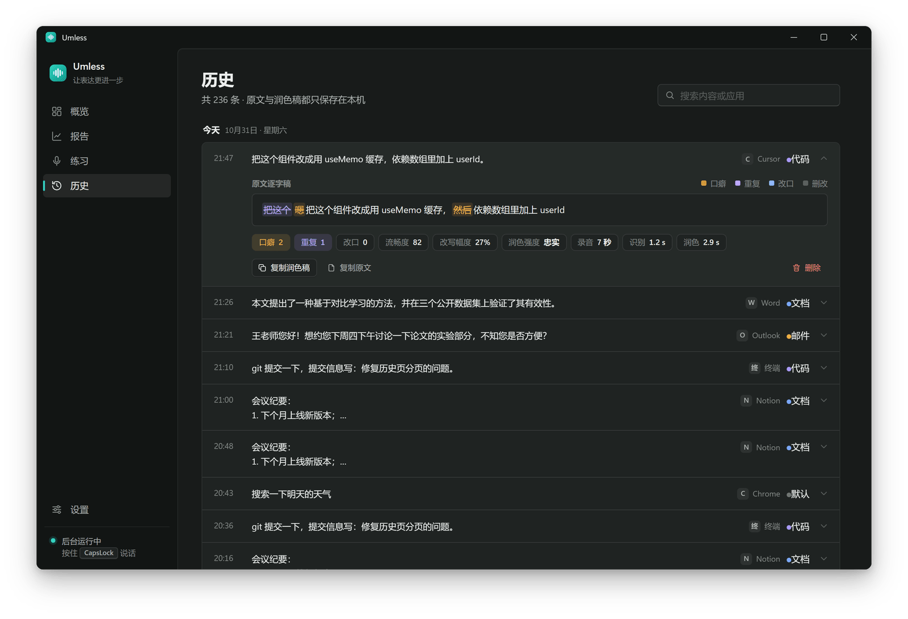</td>
  </tr>
  <tr>
    <td align="center"><sub>Fillers, repetitions, self-corrections and cut words in different colours, with timings</sub></td>
    <td align="center"><sub>Follows the system light / dark theme</sub></td>
  </tr>
</table>

### Android: a complete Chinese keyboard

<p align="center">
  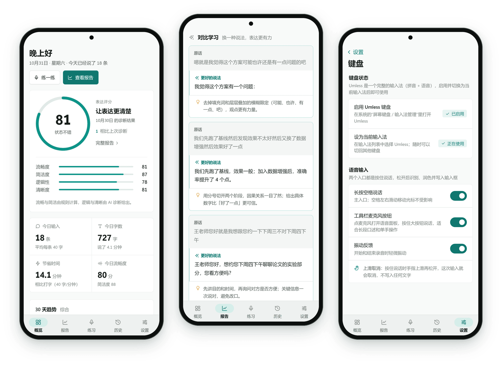
</p>

[Umless IME](https://github.com/despriber/Umless-Android) is built on [fcitx5-android](https://github.com/fcitx5-android/fcitx5-android): Pinyin, Shuangpin and the rest of typing come from upstream, Umless adds dictation and the coach.

- **Long-press the space bar to talk**, slide up to cancel; after inserting you can switch back to the original words or undo. The toolbar mic opens a voice panel for longer dictation.
- Recognition runs on the phone (sherpa-onnx + SenseVoice in a separate process); polishing uses your own LLM with prompts identical to the desktop.
- **Password fields never trigger voice**; incognito fields and blocklisted apps (common password managers, banking and payment apps by default) type as usual but leave no record.
- The main app is the same UI as the desktop: overview, report, practice, history, settings. Currently a beta (arm64).

## How it works

<p align="center">
  <picture>
    <source media="(prefers-color-scheme: dark)" srcset="docs/assets/readme/pipeline-en-dark.svg">
    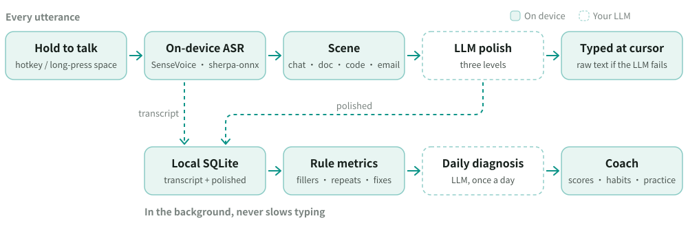
  </picture>
</p>

The desktop (Python) and Android (Kotlin) apps are independent implementations kept in lockstep by [`spec/`](spec/README.md): rules, constants and every prompt live there, and both sides must pass every golden case generated by the desktop reference implementation, with floats compared as exact doubles.

| Cases | Count | Covers |
|---|---:|---|
| `cases/metrics` | 63 | filler / repetition / correction detection, highlight segments, difflib edge cases |
| `cases/scores` | 120 | fluency, concision, overall, practice, habit cards, .5 rounding edges |
| `cases/asr` | 39 | English letter-case fixing in transcripts |
| `cases/prompts` | 13 | LLM message assembly, byte for byte |

## Getting started

**Windows**: download `Umless-Setup-<version>.exe` from [Releases](https://github.com/despriber/Umless/releases/latest) and run it (installs per user, no admin rights needed).
The installer isn't code-signed yet; if SmartScreen says "Windows protected your PC", click "More info → Run anyway".
Prefer not to install? Download `Umless-<version>-portable.zip`, unzip and run `Umless.exe`.

- **Auto-update**: the installed version checks once a day (Settings → About to check manually or turn it off), shows a notice in the window and tray, then downloads, verifies (sha256) and installs on confirmation. The portable build and source checkouts only notify.
- Updates only read a manifest from GitHub Releases and upload nothing.
- Uninstalling keeps your settings, history and models in `%APPDATA%\Umless`.

**Android**: Umless IME is released from [despriber/Umless-Android](https://github.com/despriber/Umless-Android/releases/latest) (arm64 APK), with in-app updates (sha256 and signing-certificate checks) or via [Obtainium](https://github.com/ImranR98/Obtainium).

**From source (Windows)**:

```bash
cd desktop
uv sync
uv run umless download        # download the SenseVoice model (~166 MB, sha256-checked)
uv run umless doctor          # check model, microphone and LLM connectivity
uv run umless                 # start (lives in the tray)
```

First launch opens onboarding: download the model → set up the LLM (with a connection test) → try dictating → hotkey tips. Configuration and CLI: [docs/usage.md](docs/usage.md) (Chinese).

## Privacy

- Recognition and polishing only talk to the endpoints you configure. By default ASR runs locally and the LLM points at a local Ollama (`http://localhost:11434/v1`); if you switch to a cloud API, transcripts (and the previous day's records for the daily diagnosis) are sent to that provider. No telemetry.
- Models are downloaded from the official sherpa-onnx releases (through the gh-proxy mirror first) and verified with sha256.
- The log only records lengths and timings unless you set `UMLESS_DEBUG=1`.
- Blocklisted apps (password managers by default) type as usual but are not recorded; you can pause recording, set a retention period, export everything as JSON or wipe it.

## Compared with similar projects

All good projects with different focuses. The table only lists what each project's README states (as of 2026-11); "—" means not mentioned there, not necessarily missing.

| | Umless | [CapsWriter-Offline](https://github.com/HaujetZhao/CapsWriter-Offline) | [Type4Me](https://github.com/joewongjc/type4me) | [OpenTypeless](https://github.com/tover0314-w/opentypeless) | [BiBi-Keyboard](https://github.com/BryceWG/BiBi-Keyboard) |
|---|:---:|:---:|:---:|:---:|:---:|
| Platforms | Windows · Android | Windows | macOS · iOS (beta) | Windows · macOS · Linux | Android |
| Built-in local ASR | ✅ | ✅ | ✅ (local edition) | via a local Whisper-compatible server | ✅ |
| LLM polish | ✅ | ✅ (LLM roles) | ✅ | ✅ | ✅ |
| Style per app | ✅ | — | ✅ | ✅ | — |
| Hotwords / glossary | ✅ | ✅ | ✅ | ✅ | Pro edition |
| Raw transcript history | ✅ | ✅ | ✅ | ✅ | ✅ |
| Text appears while speaking | ✗ | — | ✅ | — | — |
| Translation / voice edit commands | ✗ | — | ✅ | ✅ | ✅ |
| Audio / video file transcription | CLI (no subtitles) | ✅ (with subtitles) | — | — | — |
| Filler / repetition / correction stats and scores | ✅ | — | — | — | — |
| Daily diagnosis · habit cards · speaking practice | ✅ | — | — | — | — |
| License | MIT (Android: LGPL-2.1) | MIT | MIT | MIT | Apache-2.0 |

If you mainly want streaming text, translation or voice Q&A, those projects are more complete. If you want to drop your speaking habits while you dictate, that is what Umless is for.

## Roadmap

Directions the design docs list as "later", not yet scheduled:

- Text appearing while you speak (today a sentence is recognised as a whole, then polished, because polishing needs the full context)
- More recognition models on Android (Qwen3-ASR is too large for phones; SenseVoice only for now)
- F-Droid for the Android app
- Moving the desktop shell to Tauri (the front end is build-free HTML/CSS/JS and can be reused)

Not planned: syncing between devices, or an official hosted service (both conflict with keeping data local).

## Tech stack

| Part | Technology |
|---|---|
| Speech recognition | [sherpa-onnx](https://github.com/k2-fsa/sherpa-onnx) · SenseVoice-Small int8 · Qwen3-ASR-0.6B int8 (optional on desktop) |
| Desktop | Python · [pywebview](https://github.com/r0x0r/pywebview) (WebView2) · pystray · pynput · sounddevice · httpx · SQLite (WAL) · PyInstaller + Inno Setup |
| UI | Build-free HTML / CSS / JS shared by desktop and Android |
| Android | Kotlin · [fcitx5-android](https://github.com/fcitx5-android/fcitx5-android) · AIDL recognition process · WebView |
| LLM | Any OpenAI-compatible API (Ollama, DeepSeek, SiliconFlow, Alibaba Bailian, Zhipu, …) |

<details>
<summary><b>ASR choice</b> (12 real spoken recordings, see <code>bench/</code>)</summary>

| Model | RTF (CPU) | Memory | Keeps fillers | Notes |
|---|---|---|---|---|
| SenseVoice-Small int8 | 0.044 | ~500MB | ✅ | Default; no punctuation, the LLM fixes typos |
| Qwen3-ASR-0.6B int8 | 0.35 | ~3.3GB | ✅ most | Best accuracy and punctuation |
| Paraformer-zh int8 | 0.027 | ~390MB | ✅ | Poor on mixed Chinese/English, dropped |
| Fun-ASR-Nano int8 | 0.16 | ~1.6GB | ⚠️ | Truncates after ~27 s, dropped |

</details>

## Development

```powershell
cd desktop
uv run pytest tests -q
uv run --with playwright python tools/ui_smoke.py
```

UI checks run in headless Microsoft Edge against a mock backend (Chinese and English, light and dark, all main pages and the tour) and never read your configuration or recordings. The README screenshots come from the same mock data: `uv run --with playwright --with imagequant python tools/readme_shots.py`.

Design docs (Chinese): [desktop](docs/design.md) · [Android](docs/android-design.md) · [UI API](docs/ui-api.md) · [shared spec](spec/README.md)

## License and credits

The code in this repository is [MIT](LICENSE). The Android app is a fork of fcitx5-android and is released under LGPL-2.1-or-later, see [Umless-Android](https://github.com/despriber/Umless-Android).

Models are not distributed with the code; `umless download` fetches them from the official [sherpa-onnx](https://github.com/k2-fsa/sherpa-onnx) (Apache-2.0) releases, and each keeps its own license:

- SenseVoice-Small: [FunASR Model License](https://github.com/modelscope/FunASR/blob/main/MODEL_LICENSE) (FunAudioLLM / Alibaba Tongyi Lab, attribution required)
- Qwen3-ASR-0.6B: Apache-2.0 ([Qwen team](https://huggingface.co/Qwen/Qwen3-ASR-0.6B))
- Paraformer and Fun-ASR-Nano (only used in `bench/`): see their model cards

Thanks to [sherpa-onnx](https://github.com/k2-fsa/sherpa-onnx), [FunAudioLLM / SenseVoice](https://github.com/FunAudioLLM/SenseVoice), [Qwen3-ASR](https://huggingface.co/Qwen/Qwen3-ASR-0.6B), [fcitx5-android](https://github.com/fcitx5-android/fcitx5-android) and the [Fcitx](https://github.com/fcitx/fcitx5) community, [pywebview](https://github.com/r0x0r/pywebview) and the other open-source projects Umless builds on.
