<p align="center">
  <picture>
    <source media="(prefers-color-scheme: dark)" srcset="docs/assets/readme/banner-dark.svg">
    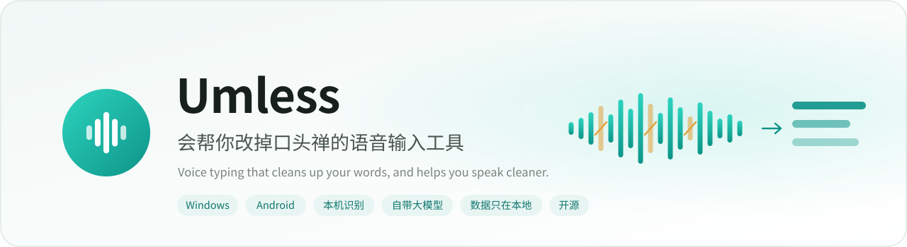
  </picture>
</p>

<p align="center">
  <b>简体中文</b> · <a href="README.en.md">English</a>
</p>

<p align="center">
  <a href="https://github.com/despriber/Umless/releases/latest"></a>
  <a href="https://github.com/despriber/Umless-Android"></a>
  
  <a href="https://linux.do/"></a>
  <a href="LICENSE"></a>
  
</p>

<p align="center">
  按住说话，松开就是干净的文字；用得越久，你说话本身也越干净。
</p>

<p align="center">
  
</p>

市面上的「语音输入 + 大模型润色」工具已经能把「嗯、那个、就是」从文字里删掉，但删掉的只是文字，说话的习惯还在。
Umless 多做了一件事：**把你说的原话留在本机，算出口癖、重复、改口，每天给你一份表达诊断，用习惯卡和口语练习帮你把它们真正改掉。**

<p align="center">
  <picture>
    <source media="(prefers-color-scheme: dark)" srcset="docs/assets/readme/before-after-dark.svg">
    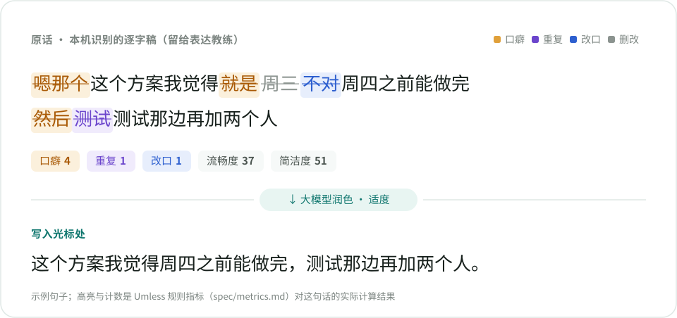
  </picture>
</p>

## 为什么是 Umless

- **输入和成长是一件事。** 平时怎么用语音输入就怎么用，表达教练在后台用同一份逐字稿工作，不需要另外「练习模式」才有数据。
- **中文优先。** 内置「嗯、那个、就是、然后、其实、对吧……」等口癖词表，识别「不对、我是说、应该是」这类改口，重复判定考虑了「看看、谢谢」这样的正常叠词。
- **评分可信、可复现。** 流畅度和简洁度由本地规则算出（字符级 diff，只有被润色删掉的口癖才算数），逻辑性和清晰度才交给大模型；算法写在 [`spec/metrics.md`](spec/metrics.md) 里，桌面端和 Android 端用同一批黄金样例验证。
- **数据只在本机。** 录音默认不保存，记录存在本机 SQLite，大模型用你自己的 OpenAI 兼容接口（本地 Ollama 也行），没有遥测。

<p align="center">
  <picture>
    <source media="(prefers-color-scheme: dark)" srcset="docs/assets/readme/coach-loop-dark.svg">
    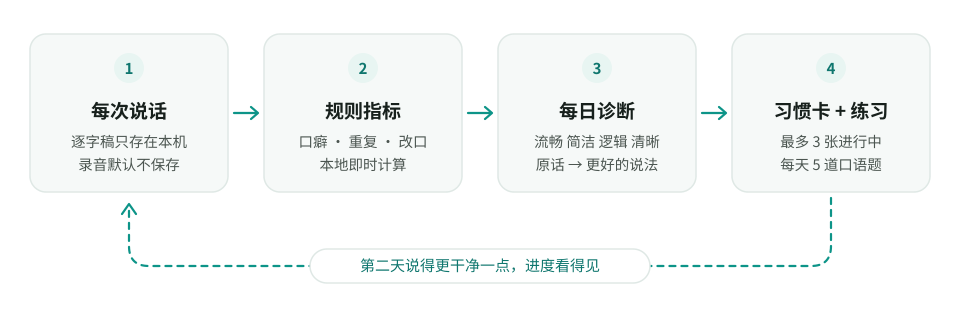
  </picture>
</p>

## 功能

### 日常输入：在任何应用里按住说话

<p align="center">
  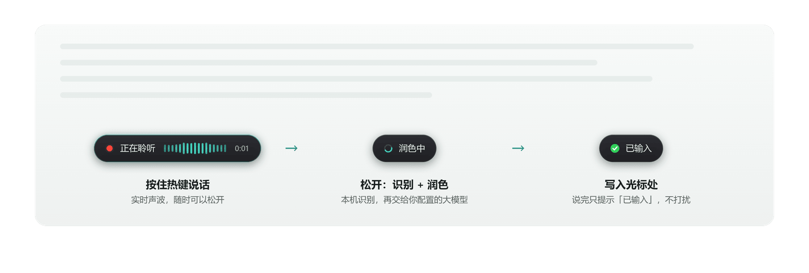
</p>

- **任意热键，按住说话。** 默认 CapsLock（轻点仍是切换大小写），也可以录制任意单键或组合键，比如 `Ctrl+Space`、`F8`、右 Ctrl。
- **本机识别。** 默认 SenseVoice-Small（sherpa-onnx，CPU 即可，仓库内测试 RTF 约 0.04）；也可以换成更准、带标点的 Qwen3-ASR，或云端接口。
- **三档润色强度：** 忠实（只去口癖、纠错、加标点）· 适度（再合并重复、理顺语序）· 重构（结论先行、可分段分点）。所有档位都不新增信息，数字、人名、否定、时间原样保留。
- **按前台应用切换风格：** 聊天、文档、代码、邮件四种场景，各自可以单独设强度；代码场景保留英文术语和标识符。
- **术语表** 帮助纠正专有名词；大模型超时或没配置时直接输出识别原文，不会卡住。
- **不打扰：** 屏幕底部的提示条不抢焦点、鼠标穿透，说完只提示「已输入」。

<table>
  <tr>
    <td width="50%">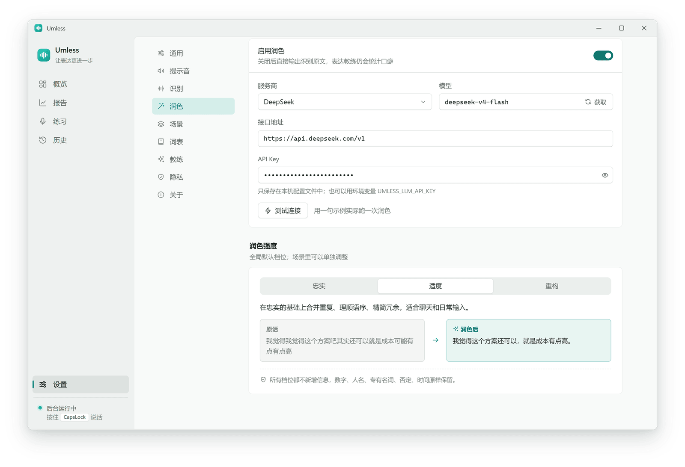</td>
    <td width="50%">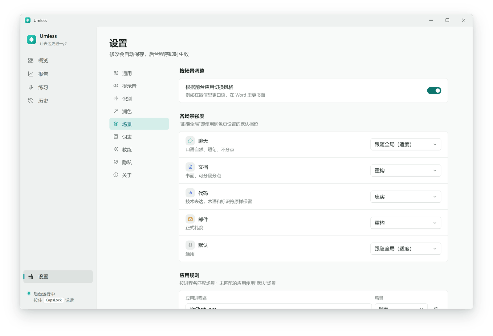</td>
  </tr>
  <tr>
    <td align="center"><sub>自带大模型（预设 Ollama、DeepSeek、硅基流动、阿里百炼、智谱，或任意兼容接口）+ 三档强度</sub></td>
    <td align="center"><sub>按前台应用自动切换场景，每个场景可单独设强度</sub></td>
  </tr>
</table>

### 表达教练：每天一份诊断

<p align="center">
  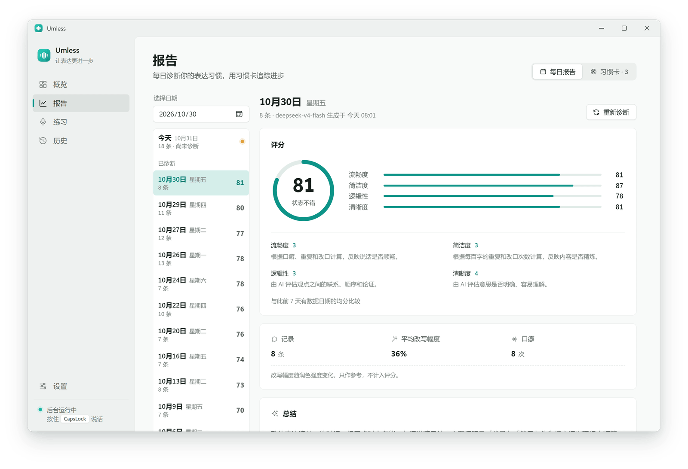
</p>

- **四项评分：** 流畅度、简洁度来自本地规则；逻辑性、清晰度由大模型按固定标准给出。综合分 = 流畅 30% + 简洁 20% + 逻辑 25% + 清晰 25%。
- **每日自动诊断前一天**（也可以随时手动诊断今天）：总结、做得好的地方、需要改进的问题（附原句证据和建议）、新发现的个人口头禅、反复识别错的术语（一键加入术语表）。
- **对比学习：** 从你当天说过的话里挑出几句，给出「原话 → 更好的说法 → 为什么」。

<p align="center">
  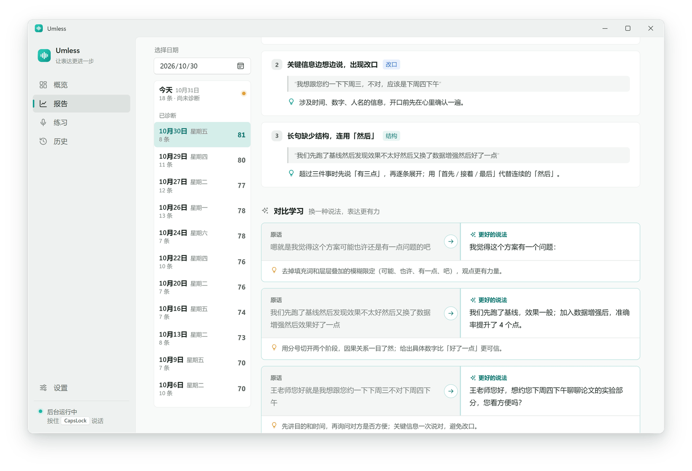
</p>

### 习惯卡：把问题变成看得见的进度

<p align="center">
  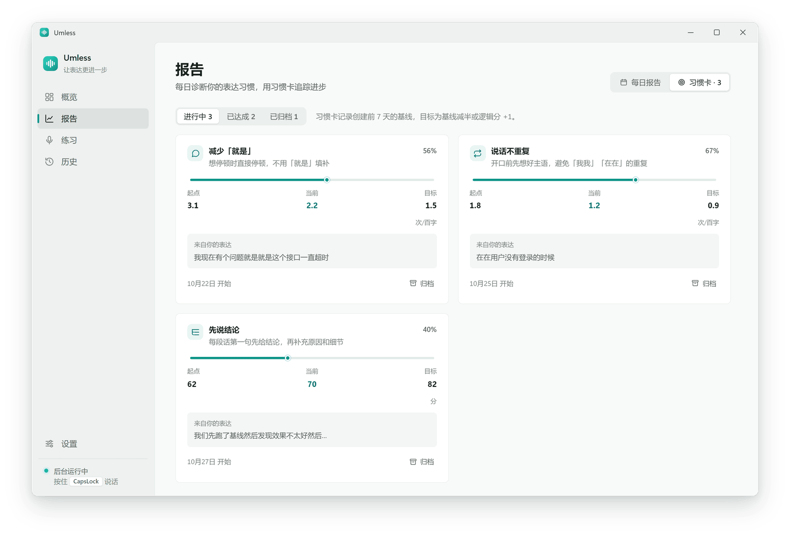
</p>

诊断里可以量化的问题会自动变成习惯卡（最多 3 张同时进行）：某个口癖的密度、重复、改口，或者逻辑性、清晰度。每张卡记录创建前 7 天的基线，目标是基线减半（或逻辑分 +1 档）；最近 7 天达标且样本足够时自动标记为「已达成」。

### 口语练习：每天 5 道题

<p align="center">
  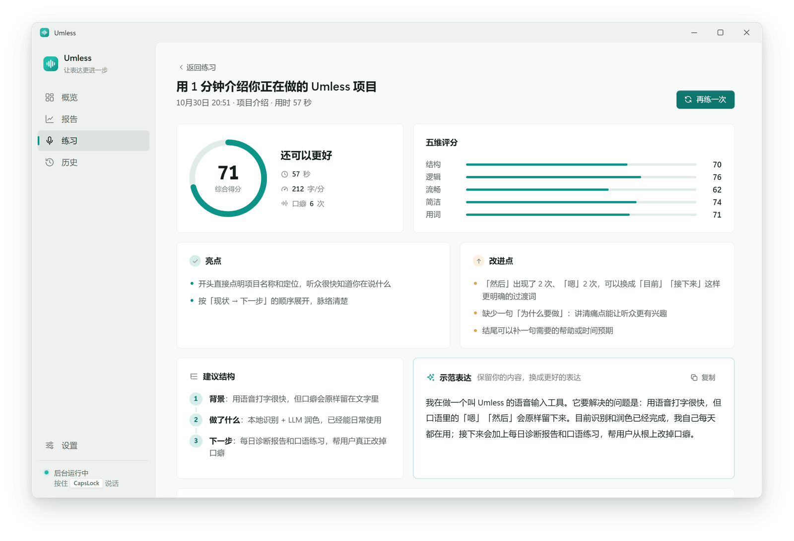
</p>

题目一部分根据你最近说过的内容出（项目、研究），一部分是通用场景（汇报、面试、讲解概念、观点表达），也可以自定义。限时 60 / 90 秒口述，从结构、逻辑、用词、流畅、简洁五个维度打分，给出亮点、改进点、建议结构和保留你原意的示范表达。

### 历史：每一句原话都标出来

<table>
  <tr>
    <td width="50%">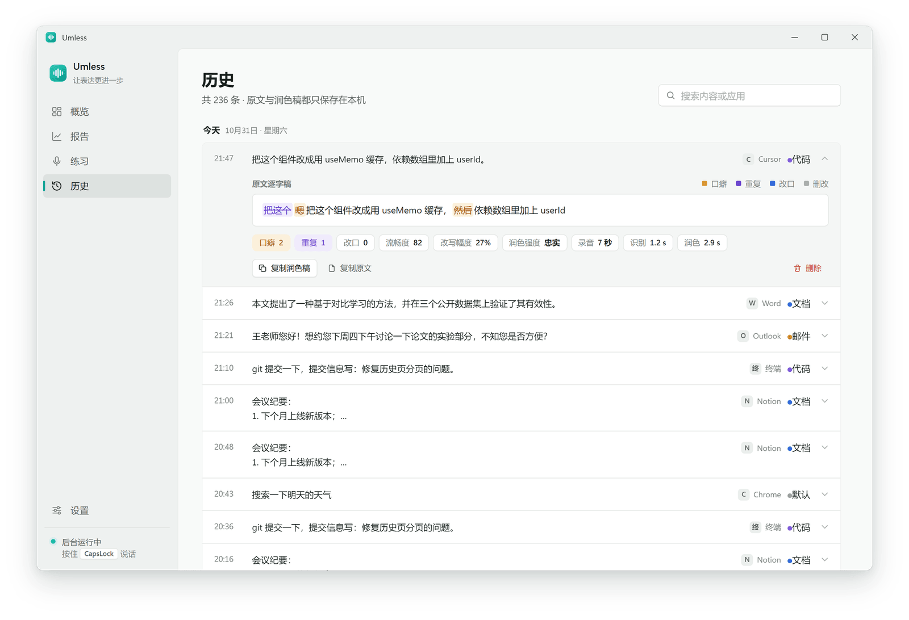</td>
    <td width="50%">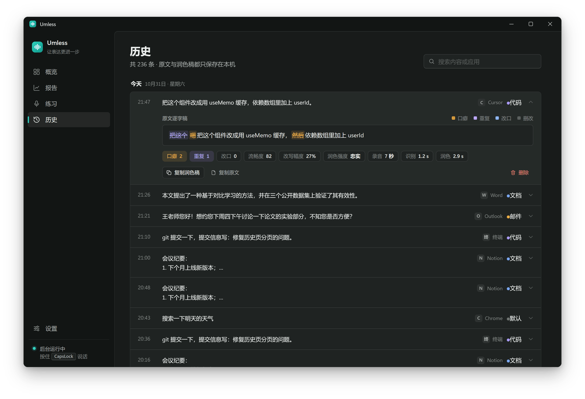</td>
  </tr>
  <tr>
    <td align="center"><sub>口癖、重复、改口、删改分色高亮，附识别与润色耗时</sub></td>
    <td align="center"><sub>跟随系统深浅色；界面支持简体中文和 English</sub></td>
  </tr>
</table>

### Android：一个完整的中文输入法

<p align="center">
  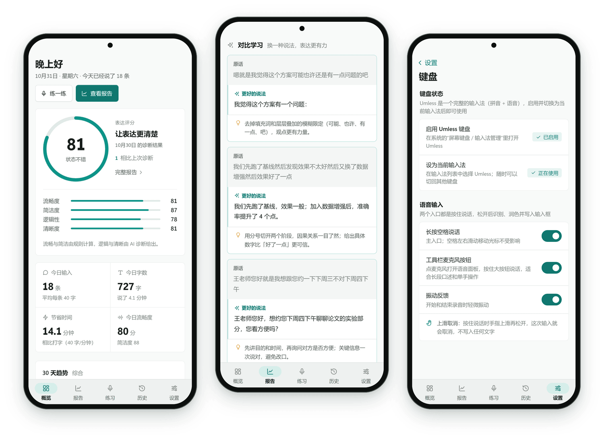
</p>

[Umless 输入法](https://github.com/despriber/Umless-Android) 基于 [fcitx5-android](https://github.com/fcitx5-android/fcitx5-android)，拼音、双拼等打字功能都来自上游，Umless 加上了语音输入和表达教练：

- **长按空格说话**，上滑取消；写入后可以一键换回「原话」或「撤销」。工具栏麦克风打开语音面板，适合长段口述。
- 识别在手机本地运行（sherpa-onnx + SenseVoice，独立进程）；润色用你自己的大模型，提示词与桌面端一字不差。
- **密码框不触发语音**，无痕输入框和黑名单应用（默认含常见密码管理器、银行与支付 App）照常输入但不记录。
- 主 App 就是桌面端的同一套界面：概览、报告、练习、历史、设置。目前是测试版（arm64）。

## 工作原理

<p align="center">
  <picture>
    <source media="(prefers-color-scheme: dark)" srcset="docs/assets/readme/pipeline-dark.svg">
    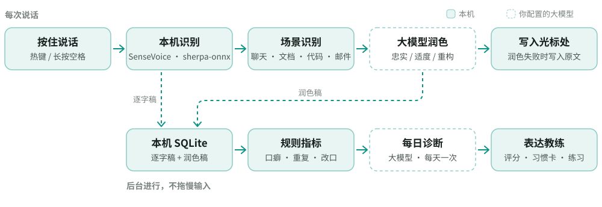
  </picture>
</p>

桌面端（Python）和 Android 端（Kotlin）是两套独立实现，靠仓库里的 [`spec/`](spec/README.md) 保证结果一致：规则算法、常量、全部提示词都以 spec 为准，桌面端生成的黄金样例两端都要逐条通过，浮点数按 double 严格相等，不设容差。

| 样例 | 数量 | 覆盖内容 |
|---|---:|---|
| `cases/metrics` | 63 | 口癖 / 重复 / 改口判定、高亮分段、difflib 复刻的边界情况 |
| `cases/scores` | 120 | 流畅度、简洁度、综合分、练习分、习惯卡、.5 取整边界 |
| `cases/asr` | 39 | 识别结果中英文大小写修正 |
| `cases/prompts` | 13 | 发给大模型的消息拼装（逐字节一致） |

## 快速开始

### 安装与更新

**Windows**：在 [Releases](https://github.com/despriber/Umless/releases/latest) 下载 `Umless-Setup-<版本>.exe` 运行即可（安装到当前用户目录，不需要管理员权限）。
安装程序暂未做代码签名，Windows SmartScreen 提示「已保护你的电脑」时点「更多信息 → 仍要运行」。
不想安装可以下载 `Umless-<版本>-portable.zip`，解压后双击 `Umless.exe`。

- **自动更新**：安装版每天检查一次新版本（「设置 → 关于」可手动检查、关闭自动检查），有新版本时在主界面和托盘提示，
  确认后自动下载、校验并安装，装完重新启动。免安装版和从源码运行只提示，需要手动下载新版本。
- 更新只读取 GitHub Releases 上的更新清单，不上传任何数据。下载源可在「设置 → 通用 → 下载源」选择自动 / GitHub 直连 / 镜像（默认自动，先走 gh-proxy 镜像），并可测试连接。
- 卸载不会删除 `%APPDATA%\Umless` 里的配置、记录和模型。

**Android**：Umless 输入法在 [despriber/Umless-Android](https://github.com/despriber/Umless-Android/releases/latest) 发布（arm64 安装包），
App 内可检查更新，也可以用 [Obtainium](https://github.com/ImranR98/Obtainium) 订阅该仓库。

发布流程（维护者）见 [docs/releasing.md](docs/releasing.md)。

### 从源码运行（Windows）

```bash
cd desktop
uv sync
uv run umless download        # 下载 SenseVoice 模型（约 166MB，sha256 校验）
uv run umless doctor          # 检查模型、麦克风、LLM 连通性
uv run umless                 # 启动（托盘常驻），或双击 run-umless.cmd 无窗口启动
```

首次启动会打开新手引导：下载模型 → 配置大模型（可「测试连接」）→ 在输入框里试说 → 热键说明。
配置项、命令行与托盘状态见 [docs/usage.md](docs/usage.md)。

## 隐私

- 识别与润色只连接你配置的地址：默认 ASR 在本机运行，默认 LLM 指向本机 Ollama（`http://localhost:11434/v1`）；改成云端接口后，语音转写文本（以及每日诊断时前一天的记录）会发送给该服务商。没有遥测或统计上报。
- 模型从 GitHub 官方 Release 下载（按下载源设置直连或经 gh-proxy 等镜像），下载后都用 sha256 校验。
- 日志 `%APPDATA%\Umless\umless.log` 默认只记录字数与耗时；排查问题时设环境变量 `UMLESS_DEBUG=1` 才会写入识别原文与润色结果。
- 应用黑名单（默认含密码管理器）里照常输入但不记录；可以暂停记录、设置保留天数，一键导出（JSON）或清空全部数据。
- 开机自启默认关闭，可在引导页或设置里开启。

## 和同类项目比较

都是很好的项目，各有侧重。下表只列各项目 README 中写明的功能（截至 2026-11）；「—」表示其 README 未提及，不代表一定没有。

| | Umless | [CapsWriter-Offline](https://github.com/HaujetZhao/CapsWriter-Offline) | [Type4Me](https://github.com/joewongjc/type4me) | [OpenTypeless](https://github.com/tover0314-w/opentypeless) | [说点啥 BiBi-Keyboard](https://github.com/BryceWG/BiBi-Keyboard) |
|---|:---:|:---:|:---:|:---:|:---:|
| 平台 | Windows · Android | Windows | macOS · iOS（测试中） | Windows · macOS · Linux | Android |
| 内置本地识别模型 | ✅ | ✅ | ✅（本地版） | 可接本地 Whisper 兼容服务 | ✅ |
| 大模型润色 | ✅ | ✅（LLM 角色） | ✅ | ✅ | ✅ |
| 按应用切换写作风格 | ✅ | — | ✅ | ✅ | — |
| 热词 / 术语表 | ✅ | ✅ | ✅ | ✅ | Pro 版 |
| 保存原文历史 | ✅ | ✅ | ✅ | ✅ | ✅ |
| 边说边出字 | ✗ | — | ✅ | — | — |
| 翻译 / 语音指令改写 | ✗ | — | ✅ | ✅ | ✅ |
| 音视频文件转录 | 命令行（无字幕） | ✅（含字幕） | — | — | — |
| 口癖 / 重复 / 改口统计与评分 | ✅ | — | — | — | — |
| 每日表达诊断 · 习惯卡 · 口语练习 | ✅ | — | — | — | — |
| 许可证 | MIT（Android 端 LGPL-2.1） | MIT | MIT | MIT | Apache-2.0 |

如果你主要需要流式出字、翻译或语音问答，上面几个项目做得更完整；如果你想在日常输入的同时把说话习惯改掉，这正是 Umless 要做的事。

## 路线图

下面是设计文档里明确列为「以后再考虑」的方向，还没有排期：

- 边说边出字（目前等一句话说完、整段识别后再润色，因为润色需要完整上下文）
- Android 端提供更多识别模型（手机上 Qwen3-ASR 太大，目前只有 SenseVoice）
- Android 端上架 F-Droid
- 桌面端前端迁移到 Tauri（前端是无构建步骤的原生 HTML/CSS/JS，可直接复用）

不打算做：双端数据同步、官方托管的云服务（与「数据只在本地」的原则冲突）。

## 技术栈

| 部分 | 用到的技术 |
|---|---|
| 语音识别 | [sherpa-onnx](https://github.com/k2-fsa/sherpa-onnx) · SenseVoice-Small int8 · Qwen3-ASR-0.6B int8（桌面端可选） |
| 桌面端 | Python · [pywebview](https://github.com/r0x0r/pywebview)（WebView2）· pystray · pynput · sounddevice · httpx · SQLite（WAL）· PyInstaller + Inno Setup |
| 界面 | 无构建步骤的原生 HTML / CSS / JS，桌面端与 Android 端共用 |
| Android | Kotlin · [fcitx5-android](https://github.com/fcitx5-android/fcitx5-android) · AIDL 独立识别进程 · WebView |
| 大模型 | 任意 OpenAI 兼容接口（Ollama、DeepSeek、硅基流动、阿里百炼、智谱……） |

<details>
<summary><b>ASR 选型结论</b>（12 条真实口语录音对比，详见 <code>bench/</code>）</summary>

| 模型 | RTF（CPU） | 内存 | 口癖保留 | 备注 |
|---|---|---|---|---|
| SenseVoice-Small int8 | 0.044 | ~500MB | ✅ | 默认；无标点，错字交给 LLM 修正 |
| Qwen3-ASR-0.6B int8 | 0.35 | ~3.3GB | ✅ 最全 | 准确率与标点最好 |
| Paraformer-zh int8 | 0.027 | ~390MB | ✅ | 中英混说差，淘汰 |
| Fun-ASR-Nano int8 | 0.16 | ~1.6GB | ⚠️ | 超过约 27 秒截断，淘汰 |

</details>

## 开发

| 目录 | 内容 |
|---|---|
| `desktop/` | Windows 桌面端（Python） |
| `spec/` | 两端共享的规则、常量、提示词与黄金样例 |
| `docs/` | 设计文档、界面接口约定、发布流程 |
| `bench/` | ASR 模型选型对比脚本 |

```powershell
cd desktop
uv run pytest tests -q
uv run --with playwright python tools/ui_smoke.py
```

界面检查使用本机 Microsoft Edge 的无头模式与模拟后端，覆盖中英文、深浅色、主要页面和功能导览；截图与检查报告写入 `desktop/.testhome/ui-smoke/`，不读取个人配置和录音。实际麦克风、全局热键、提示音与跨应用粘贴需要在 Windows 桌面中试用。

README 里的截图同样来自模拟后端（固定种子的示例数据），用 `uv run --with playwright --with imagequant python tools/readme_shots.py` 重新生成。

设计文档：[桌面端](docs/design.md) · [Android 端](docs/android-design.md) · [界面接口](docs/ui-api.md) · [共享规范](spec/README.md)

## 许可证与致谢

本仓库代码以 [MIT](LICENSE) 许可发布；Android 端是 fcitx5-android 的分支，以 LGPL-2.1-or-later 发布，见 [Umless-Android](https://github.com/despriber/Umless-Android)。

模型文件不随仓库分发，运行 `umless download` 时从 [sherpa-onnx](https://github.com/k2-fsa/sherpa-onnx)（Apache-2.0）的官方 Release 下载，使用时须遵守各自的原始许可：

- SenseVoice-Small：[FunASR Model License](https://github.com/modelscope/FunASR/blob/main/MODEL_LICENSE)（FunAudioLLM / 阿里巴巴通义实验室，需保留署名）
- Qwen3-ASR-0.6B：Apache-2.0（[Qwen 团队](https://huggingface.co/Qwen/Qwen3-ASR-0.6B)）
- `bench/` 中用于对比的 Paraformer、Fun-ASR-Nano：以各自模型卡的许可为准

感谢 [sherpa-onnx](https://github.com/k2-fsa/sherpa-onnx)、[FunAudioLLM / SenseVoice](https://github.com/FunAudioLLM/SenseVoice)、[Qwen3-ASR](https://huggingface.co/Qwen/Qwen3-ASR-0.6B)、[fcitx5-android](https://github.com/fcitx5-android/fcitx5-android) 与 [Fcitx](https://github.com/fcitx/fcitx5) 社区、[pywebview](https://github.com/r0x0r/pywebview) 等开源项目。

本项目认可并积极参与 [LINUX DO](https://linux.do/) 社区，欢迎在那里交流使用体验和建议。

<p align="center">交流社区：<a href="https://linux.do/">LINUX DO</a></p>
